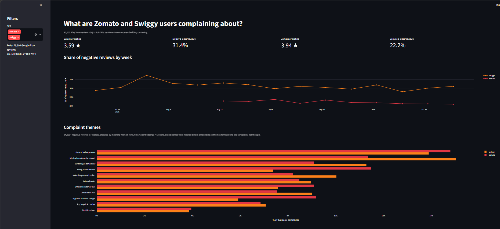

# Review Insights: what are Zomato and Swiggy users complaining about?

An end-to-end NLP project on **80,000 Google Play reviews** (40,000 per app, Jul–Oct 2026):
scraping → SQL → sentiment models → complaint clustering → interactive dashboard.

**Live dashboard:** {{(https://review-insights-fyob6x9wrejmam9fmncecg.streamlit.app/)}}



## Why I built this

This started after an online order which had a refund trouble. I've always wanted to know how Zomato and Swiggy really compare from the user's side: what people complain about, and which app handles them better. I also wanted to build a live dashboard, so I blended both goals into one project.

## Key findings

- **Swiggy draws more complaints:** 31.4% of Swiggy reviews are 1–2★ vs 22.2% for Zomato.
- **Each app fails differently.** Zomato over-indexes on *wrong or spoiled food* (11.5% vs 7.4%) and *high fees & hidden charges* (9.2% vs 5.9%). Swiggy over-indexes on *missing items & partial refunds* (15.0% vs 11.4%).
- **1 in 10 complaints is an explicit churn threat** ("better use the other app").
- **Star ratings undercount anger:** 2.7% of reviews contradict their own stars, e.g. 5★ reviews that say "very very worst app… fraud company".
- **Replying ≠ resolving:** Swiggy replies to ~100% of reviews (templated), Zomato to only 16% of 1★ reviews.

## Pipeline

| Step | What | Tools |
|---|---|---|
| 1. Collect | 40k newest reviews per app; user names and photos dropped | `google-play-scraper` |
| 2. Store & query | Cleaned, deduplicated, loaded with a typed schema; 7 analysis queries (window functions, trends, version ratings) | SQLite, [`sql/analysis.sql`](sql/analysis.sql) |
| 3. Sentiment | Rule-based baseline vs transformer, evaluated against star ratings | VADER, RoBERTa (`cardiffnlp/twitter-roberta-base-sentiment-latest`) |
| 4. Themes | 14k negative reviews embedded, clustered, labelled with c-TF-IDF, named by hand | `all-MiniLM-L6-v2`, KMeans, silhouette score |
| 5. Dashboard | Filters, trends, theme comparison, theme explorer | Streamlit, Plotly |

## Results

**Sentiment: model vs star rating** (21,863 reviews with 5+ words)

| Model | Accuracy | Macro-F1 |
|---|---|---|
| VADER (rule-based) | 69.1% | 0.53 |
| RoBERTa (transformer) | **81.2%** | **0.62** |

RoBERTa detects complaints well (negative class: precision 0.94, recall 0.87). Both models struggle with **neutral (F1 0.14)**: 3★ reviews are genuinely mixed and make up only 4% of the data.

**Complaint themes** (k = 11, chosen by silhouette score)

| Theme | Share | Zomato | Swiggy |
|---|---|---|---|
| General bad experience | 14.2% | 14.8% | 13.9% |
| Missing items & partial refunds | 13.6% | 11.4% | 15.0% |
| Switching to competitor | 10.4% | 9.1% | 11.3% |
| Rider delays & stuck orders | 9.3% | 8.2% | 10.0% |
| Wrong or spoiled food | 9.0% | 11.5% | 7.4% |
| Late deliveries | 8.8% | 8.5% | 9.0% |
| Cancellation fees | 8.4% | 7.5% | 9.0% |
| Unhelpful customer care | 8.2% | 9.1% | 7.6% |
| High fees & hidden charges | 7.2% | 9.2% | 5.9% |
| App bugs & AI chatbot | 7.0% | 6.9% | 7.1% |
| Hinglish reviews | 3.9% | 4.0% | 3.9% |

## A bug I caught

The first clustering produced two clusters that were really just *"reviews that mention Swiggy"* (19.2% of Swiggy complaints vs 1.2% of Zomato's) and *"reviews that mention Zomato"* (24.2% vs 3.1%). The brand name dominated the embedding.

**Fix:** mask brand names (`zomato`, `swiggy`, `instamart`, common misspellings) with "the app" before embedding. After the fix, no theme differs between apps by more than ~4 points, so clusters form around the complaint, not the brand.

## Limitations

- Play Store reviewers skew unhappy; this is not a random sample of customers.
- Only ~3 months of data, so trends are short-term.
- Star ratings are a noisy proxy for sentiment (see the 2.7% mismatch).
- Theme names are a human judgement from keywords and samples.
- Hinglish reviews form their own cluster; a multilingual model would sort them by topic.

## Run it yourself

```bash
git clone {{your repo URL}}
cd review-insights
python -m venv venv && venv\Scripts\activate      # Mac/Linux: source venv/bin/activate
pip install -r requirements.txt            # enough to run the dashboard
streamlit run app.py

# to rebuild the data and models from scratch:
pip install -r requirements-pipeline.txt
python src/scrape.py        # ~20 min, writes data/raw/*.csv
python src/load_db.py       # builds data/reviews.db
python src/run_sql.py       # runs sql/analysis.sql
python src/sentiment.py     # ~1 hr on CPU, resumable
python src/cluster.py       # ~10 min
```

The repo includes `data/reviews.db` with all results, so the dashboard works straight after cloning.

## Project structure

```
app.py                 Streamlit dashboard
src/scrape.py          collect reviews
src/load_db.py         clean + load into SQLite
src/run_sql.py         run analysis queries
src/sentiment.py       VADER vs RoBERTa
src/cluster.py         embeddings + KMeans + c-TF-IDF
sql/analysis.sql       SQL analysis
data/theme_names.csv   human-named themes
data/reviews.db        all data and model outputs
```

---
Built by Karthikeya · {{LinkedIn URL}}
